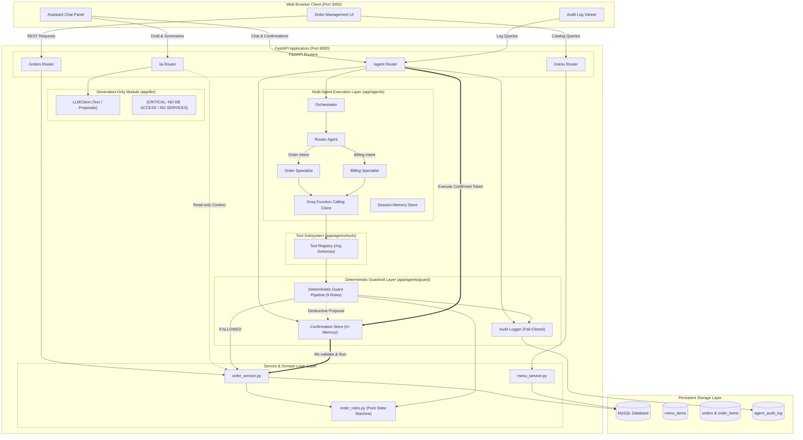
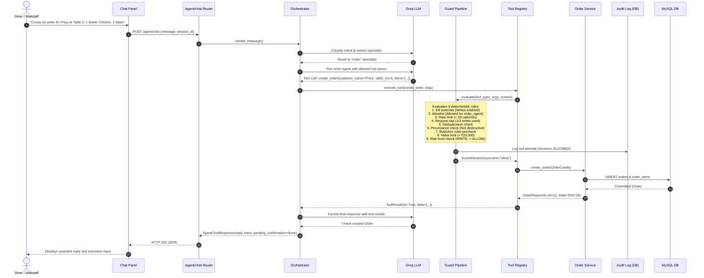
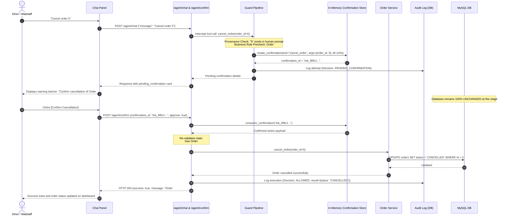
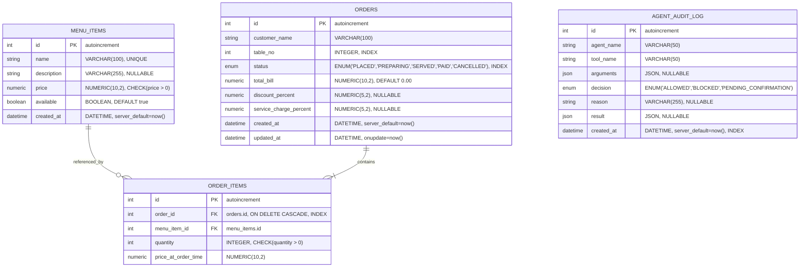

# System Architecture & Technical Design

This document details the software architecture, data flow, component boundaries, and key design decisions of the Restaurant Order Management System (OMS).

---

## 1. System Architecture Overview

The system is organized into decoupled layers that strictly isolate **untrusted model text generation** from **state-mutating database execution**.

---

## 2. Sequence Diagrams

### 2.1 Standard Safe Agent Execution ("Create an order for Priya...")

In a standard safe write action, the model's function call is checked against the deterministic guard. Because `create_order` has `RiskLevel.WRITE`, it is validated against quotas and limits, executed directly, and recorded in the audit log.

---

### 2.2 Guarded Destructive Action ("Cancel Order 5")

When an agent proposes a destructive action (`cancel_order` or `delete_order`), the guard intercepts the operation, issues an ephemeral, single-use confirmation token, and presents the decision to the human user. No database state changes until the user explicitly confirms.

---

## 3. Relational Database Schema (ER Diagram)

The relational schema is implemented in SQLAlchemy 2.x and persisted in MySQL 8.0:

---

## 4. Layer Responsibilities & Isolation Boundaries

To prevent security vulnerabilities and architectural decay, the codebase enforces strict separation of concerns:

| Layer | Permitted Capabilities | Prohibited Capabilities | Enforcement Mechanism |
| :--- | :--- | :--- | :--- |
| **Routers** (`app/routers/`) | HTTP parameter extraction, status codes, dependency injection (`db: Session`). | Must **not** contain business logic or direct database queries. | Code review & structural encapsulation. |
| **Services** (`app/services/`) | Database transactions, domain operations, calculations. | Must **not** import FastAPI, HTTP exceptions, or request objects. | Automated unit tests verify zero FastAPI imports in `app/services/`. |
| **Pure Rules** (`app/services/order_rules.py`) | Transition validation, business permission checks. | Must **not** access the database, network, or external state. | Tested with table-driven unit tests. |
| **Generation LLM** (`app/llm/`) | Free-text generation, proposal structuring, summarization. | Must **not** access the database, call services, or perform tool execution. | AST static analysis tests (`tests/unit/test_llm_boundary.py`) fail if DB/service imports are added. |
| **Guard Pipeline** (`app/agents/guard/`) | Deterministic validation, rate limiting, kill switches. | Must **not** call LLMs or prompt external models for security opinions. | Structural AST test (`test_guard_module_has_zero_llm_imports`) asserts zero LLM imports. |

---

## 5. Architectural Design Decisions & Rationales

### 5.1 Historical Price Snapshotting (`price_at_order_time`)
- **Decision**: When an order item is added, `menu_items.price` is copied into `order_items.price_at_order_time`.
- **Rationale**: Menu prices fluctuate over time. An order placed at ₹260.00 must not change in retrospect if the restaurant later updates the item price to ₹280.00. Billing and financial auditability require immutability of historical transaction prices.

### 5.2 Services Reused as Agent Tools
- **Decision**: Agent tools in `app/agents/tools/registry.py` wrap the identical service functions used by the standard REST API (`create_order`, `change_status`, `update_bill`, etc.).
- **Rationale**: Eliminates duplicate business logic. Every validation check, constraint, and calculation applied to human waitstaff is inherently enforced when an AI agent performs the action.

### 5.3 Pure Domain State Machine (`order_rules.py`)
- **Decision**: Allowed order transitions and mutation permissions are isolated in a dependency-free module.
- **Rationale**: Allows the deterministic guard to precheck whether an operation is legal before presenting a confirmation card or attempting an execution, without initiating database locks or side effects.

### 5.4 Strict Pydantic Schemas (`extra="forbid"`)
- **Decision**: All request models and agent tool argument schemas set `model_config = ConfigDict(extra="forbid")`.
- **Rationale**: Blocks prompt injection attacks where an attacker tricks an LLM into injecting unrecognized parameters, bypassing filters, or polluting data structures.

### 5.5 Fail-Closed Audit Logging
- **Decision**: Audit records are written via a dedicated database session with immediate flush. If audit logging fails, the entire tool operation is rejected.
- **Rationale**: Ensures complete visibility into all agent attempts. An attacker cannot suppress audit records by intentionally triggering transaction rollbacks.

### 5.6 In-Memory Confirmations and Session Memory (Case Study vs. Production)
- **Current Implementation**: Ephemeral confirmations and session histories are stored in process-local memory (`_pending_confirmations` dictionary with thread locks).
- **Production Architecture**: In a distributed multi-worker deployment (e.g. Kubernetes with multiple Uvicorn workers), this in-memory store would be replaced with **Redis** or a database-backed distributed lock with native TTL support (`SET key val EX 120 NX`).
