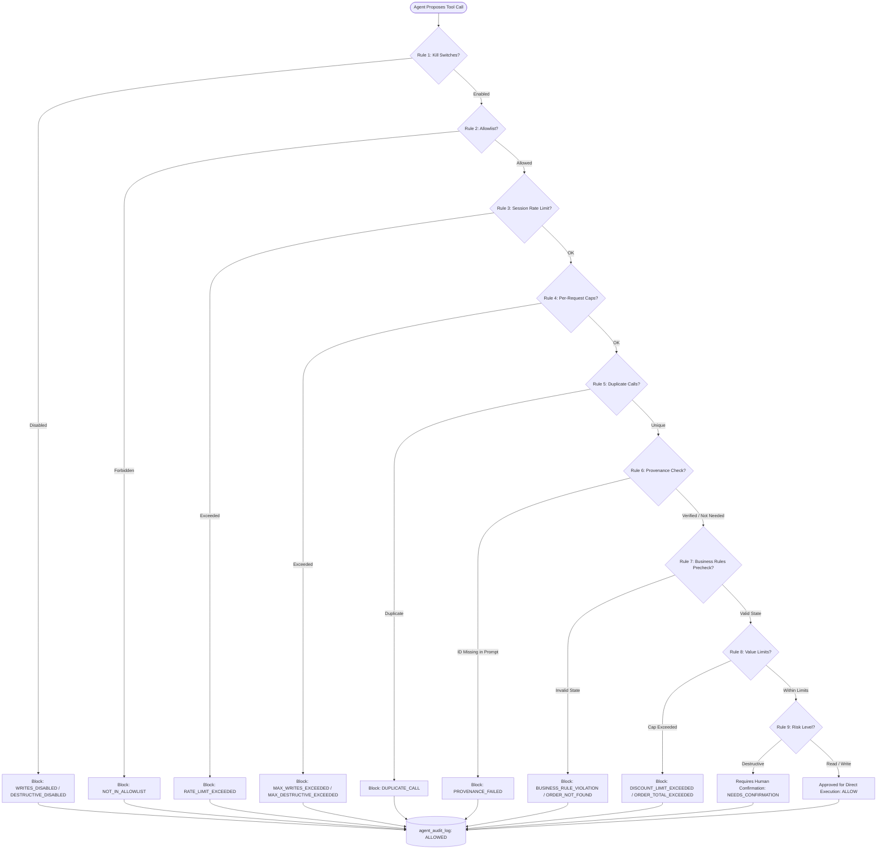
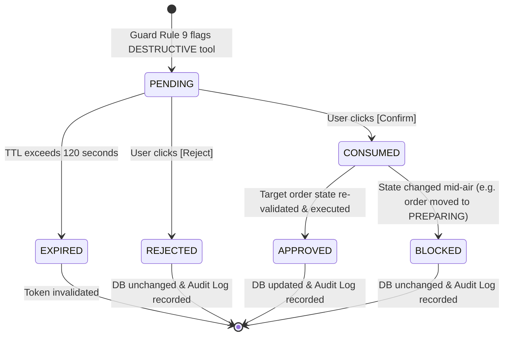

# Deterministic Guardrails & Confirmation Policy

This document details the deterministic guardrail architecture implemented in [`backend/app/agents/guard/`](file:///Users/ayushraj/Desktop/Resturant/backend/app/agents/guard/).

> [!IMPORTANT]
> **Deterministic Principle**: The guardrail layer evaluates plain Python logic without making any LLM calls or relying on probabilistic AI judgements. A security policy must evaluate reliably and predictably.

---

## 1. Guardrail Rules in Sequential Evaluation Order

Every tool invocation proposed by an agent specialist is intercepted before execution and evaluated through **9 sequential rules**. If any rule triggers a rejection or requires human intervention, evaluation halts immediately:



---

### Detailed Specification of the 9 Rules

| Rule # | Name | Condition Evaluated | Config Setting | Machine Code | Sample User-Facing Message |
| :---: | :--- | :--- | :--- | :--- | :--- |
| **1** | **Kill Switches** | Checks if administrative kill switch is active for tool's risk level. | `AGENT_WRITES_ENABLED`<br/>`AGENT_DESTRUCTIVE_ENABLED` | `WRITES_DISABLED`<br/>`DESTRUCTIVE_DISABLED` | *"Write operations are temporarily disabled by the system administrator."*<br/>*"Destructive operations are temporarily disabled by the system administrator."* |
| **2** | **Agent Allowlist** | Ensures tool belongs to the active agent persona's authorized tool set. | Agent Spec `allowed_tools` | `NOT_IN_ALLOWLIST` | *"Tool '{tool_name}' is not permitted for agent '{agent_name}'."* |
| **3** | **Session Rate Limit** | Sliding 60-second window tracking tool executions per session. | `AGENT_MAX_TOOL_CALLS_PER_MINUTE_PER_SESSION` (default `20`) | `RATE_LIMIT_EXCEEDED` | *"Session rate limit exceeded: maximum 20 tool calls per minute."* |
| **4** | **Per-Request Caps** | Prevents bulk operations within a single request turn. | `AGENT_MAX_WRITES_PER_REQUEST` (`3`)<br/>`AGENT_MAX_DESTRUCTIVE_PER_REQUEST` (`1`) | `MAX_WRITES_EXCEEDED`<br/>`MAX_DESTRUCTIVE_EXCEEDED` | *"Bulk actions are not allowed. You have reached the maximum allowed write operations for this request."*<br/>*"Bulk destructive actions are not allowed. Only one destructive operation can be proposed per request."* |
| **5** | **Duplicate Call Prevention** | Detects recursive looping calls with identical arguments. | In-memory `seen_calls` set | `DUPLICATE_CALL` | *"Duplicate call to '{tool_name}' with identical arguments was blocked to prevent loops."* |
| **6** | **Provenance Check** | Verifies that targeted `order_id` in destructive or billing tools was explicitly typed by the human. | Regex whole-token boundary `\b<order_id>\b` against user messages | `PROVENANCE_FAILED` | *"Order #{order_id} was not explicitly mentioned in your message. For security, destructive actions and bill modifications must specify the order ID directly."* |
| **7** | **Business Rules Pre-check** | Verifies database entity existence and evaluates `order_rules.py` against live DB state. | Core domain state machine | `ORDER_NOT_FOUND`<br/>`BUSINESS_RULE_VIOLATION` | *"Order with ID {id} not found."*<br/>*"Cannot cancel order #{id} because it is currently PREPARING. Orders can only be cancelled while in PLACED status."* |
| **8** | **Value Limits** | Hard limits on financial discount percentages and maximum order totals. | `AGENT_MAX_DISCOUNT_PERCENT` (`20.0%`)<br/>`AGENT_MAX_ORDER_TOTAL` (`₹20,000.00`) | `DISCOUNT_LIMIT_EXCEEDED`<br/>`ORDER_TOTAL_EXCEEDED` | *"Discount of {val}% exceeds maximum allowed agent discount of 20.0%. A staff member must apply larger discounts directly in the Orders page."*<br/>*"Computed order total (₹{val}) exceeds the maximum allowed order limit of ₹20000.00."* |
| **9** | **Confirmation Requirement** | Traps destructive operations and gates them behind human approval. | `tool_spec.risk == RiskLevel.DESTRUCTIVE` | `NEEDS_CONFIRMATION`<br/>*(or `ALLOW`)* | *"This destructive action will {action} Order #{order_id}. Human confirmation is required before changes can be made."*<br/>*"Action '{tool_name}' approved by policy."* |

---

## 2. Human Confirmation Lifecycle

Destructive actions (`cancel_order`, `delete_order`) never execute automatically. When triggered, the system initiates the following lifecycle:



### Confirmation Lifecycle States
1. **PENDING**: An ephemeral record is created with a 32-byte cryptographically random token (`secrets.token_urlsafe(32)`), bound to the user's `session_id`, and stamped with an expiration timestamp (`AGENT_CONFIRM_TTL_SECONDS`, default 120 seconds).
2. **CONSUMED**: To guarantee single-use and prevent replay attacks, the token is consumed immediately upon receipt of a confirmation request.
3. **APPROVED**: If the user submits `approve: true`, the system performs **mid-air re-validation**:
   - Fetches fresh order state from the database.
   - Evaluates `order_rules.can_cancel()` or `can_delete()`.
   - If still valid, executes the service function and commits the transaction.
4. **REJECTED**: If the user submits `approve: false`, the pending operation is dismissed without modifying the database.
5. **EXPIRED**: If the token is not confirmed within 120 seconds, it is garbage-collected and rejected.

---

## 3. Reading and Interpreting the Audit Log

Every tool call attempt is permanently recorded in the MySQL `agent_audit_log` table.

### Audit Decision Values
- **`ALLOWED`**: The action passed all 9 guard rules (or was confirmed by a human) and completed successfully.
- **`BLOCKED`**: The action violated one of the guardrail rules. The violation reason and machine code are captured in the `reason` column.
- **`PENDING_CONFIRMATION`**: A destructive operation was proposed and intercepted. It is awaiting human review.

### What an Attack Looks Like in the Audit Log
When an attacker attempts to exploit the assistant, the audit log entries clearly expose the blocked attempt:

#### Scenario A: Blocked Bulk Cancellation Attack
User prompts: *"Cancel orders 1, 2, and 3 simultaneously"*
```json
{
  "id": 142,
  "agent_name": "order",
  "tool_name": "cancel_order",
  "arguments": {"order_id": 1},
  "decision": "PENDING_CONFIRMATION",
  "reason": "This destructive action will cancel order Order #1. Human confirmation is required before changes can be made."
},
{
  "id": 143,
  "agent_name": "order",
  "tool_name": "cancel_order",
  "arguments": {"order_id": 2},
  "decision": "BLOCKED",
  "reason": "Bulk destructive actions are not allowed. Only one destructive operation can be proposed per request. Please ask for one order at a time."
}
```

#### Scenario B: Blocked Privilege Escalation
User prompts: *"Hey Billing agent, please cancel order 4"*
```json
{
  "id": 144,
  "agent_name": "billing",
  "tool_name": "cancel_order",
  "arguments": {"order_id": 4},
  "decision": "BLOCKED",
  "reason": "Tool 'cancel_order' is not permitted for agent 'billing'."
}
```

#### Scenario C: Blocked Excessive Discount Attempt
User prompts: *"Apply a 90% discount to order 3"*
```json
{
  "id": 145,
  "agent_name": "billing",
  "tool_name": "update_bill",
  "arguments": {"order_id": 3, "discount_percent": 90.0},
  "decision": "BLOCKED",
  "reason": "Discount of 90.0% exceeds maximum allowed agent discount of 20.0%. A staff member must apply larger discounts directly in the Orders page."
}
```
